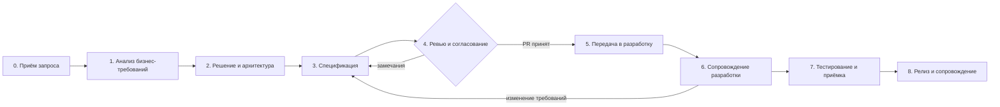
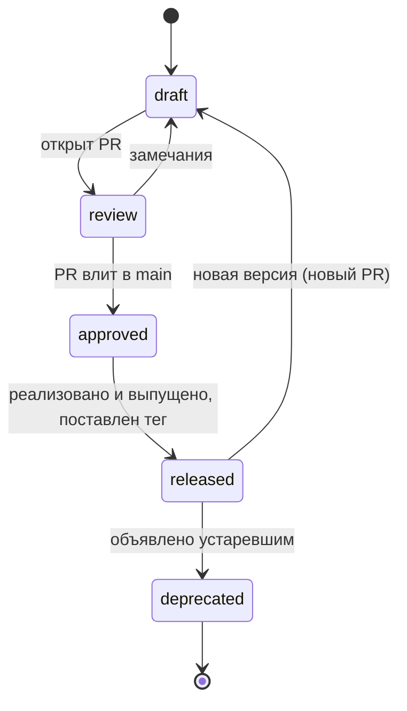

# Процесс работы системного аналитика

> Версия 0.1 · черновик для обсуждения в команде
> Этот файл — источник истины по процессу. Изменения — через Pull Request, как и для любого артефакта.

## Содержание

1. [Принципы](#1-принципы)
2. [Где что живёт](#2-где-что-живёт)
3. [Процесс от запроса до релиза](#3-процесс-от-запроса-до-релиза)
4. [Роли и ответственность (RACI)](#4-роли-и-ответственность-raci)
5. [Статусы и согласование через Pull Request](#5-статусы-и-согласование-через-merge-request)
6. [Версионирование и изменения](#6-версионирование-и-изменения)
7. [Связь с Confluence и Apidog](#7-связь-с-confluence-и-apidog)
8. [Definition of Ready и Definition of Done](#8-definition-of-ready-и-definition-of-done)
9. [Идентификаторы и именование](#9-идентификаторы-и-именование)
10. [Лучшие практики](#10-лучшие-практики)
11. [Антипаттерны](#11-антипаттерны)
12. [План внедрения](#12-план-внедрения)

---

## 1. Принципы

| # | Принцип | Что это значит на практике |
|---|---|---|
| P1 | **Один источник истины** | Каждый факт живёт в одном месте. Контракт API — только в `openapi.yaml`, модель данных — только в `.dbml`. ТЗ и Confluence на них **ссылаются**, а не копируют. |
| P2 | **Docs-as-code** | То, что читают разработчики и тестировщики (контракты, модели данных, карточки методов, диаграммы), хранится в git как текст: история, diff, ревью, откат. |
| P3 | **Contract-first** | Контракт API описывается и согласуется **до** начала разработки. Разработка реализует согласованный контракт, а не наоборот. |
| P4 | **Согласование = Pull Request** | «Согласовано» — это PR, принятый в `main` с одобрениями нужных ролей. Кто и когда одобрил, git помнит сам. |
| P5 | **Ссылка на версию, не на «последнее»** | ТЗ ссылается на тег или коммит (`example-api-v1.2.0`), а не на ветку. Иначе согласованное ТЗ тихо поменяет смысл. |
| P6 | **Машиночитаемость** | Метаданные артефактов (статус, версия, владелец) — в front matter. Реестры и проверки генерируются скриптом, а не ведутся руками. |
| P7 | **Автоматическая проверка** | Синтаксис OpenAPI/DBML, правила стиля API и связность артефактов проверяет CI на каждый PR. Ревьюер тратит время на смысл, а не на запятые. |

---

## 2. Где что живёт

| Артефакт | Источник истины | Формат | Кто основной читатель | Публикация |
|---|---|---|---|---|
| BRD / бизнес-требования | Confluence (бизнес) | Страница / .docx | Бизнес, аналитик | Confluence |
| C4-модель, ADR | git: `adr/`, `architecture/` | Markdown, Structurizr DSL | Архитекторы, тимлиды | Ссылка из Confluence |
| **ТЗ на флоу** | Confluence / СЭД (для согласования с бизнесом) | Шаблон .docx / страница | Бизнес, разработка, QA | Confluence |
| Описание экранных форм | Confluence | Шаблон .docx / страница | Frontend, дизайн, QA | Confluence |
| **Контракт API** | **git:** `systems/<sys>/api/openapi.yaml` | OpenAPI 3.x | Backend, интеграторы, QA | Redoc-страница из CI, импорт в Apidog |
| **Карточка метода** | **git:** `systems/<sys>/methods/API-NNN-*.md` | Markdown + front matter | Backend, QA, сопровождение | GitHub (рендер), ссылка из Confluence |
| **Модель данных (ERD)** | **git:** `systems/<sys>/erd/*.dbml` | DBML | Backend, DBA, DWH | dbdiagram.io / SVG из CI |
| Sequence / state | **git:** `systems/<sys>/diagrams/*.puml` | PlantUML | Все технические роли | SVG из CI, вставка в ТЗ |
| Интеграционный паспорт | **git:** `systems/<sys>/integrations/IP-*.md` | Markdown | Интеграторы, сопровождение | GitHub |
| Реестр методов | **генерируется** в `registry/METHODS.md` | Markdown | Все | GitHub, ссылка из Confluence |

**Правило разделения.** Если документ читает и согласует **бизнес** — Confluence/СЭД. Если документ читает **разработка и QA** и он меняется вместе с кодом — git.

> Альтернатива «всё в git, включая ТЗ» тоже рабочая (ТЗ в Markdown, PDF собирается в CI), но требует, чтобы бизнес-согласующие читали PR или PDF. Начните с гибрида; к полному docs-as-code можно прийти позже. Обоснование — `adr/ADR-0001-docs-as-code.md`.

---

## 3. Процесс от запроса до релиза

### Этап 0. Приём запроса

| | |
|---|---|
| **Цель** | Понять, что просят, зачем и с каким приоритетом; решить, нужен ли системный анализ |
| **Вход** | Заявка/эпик в трекере, инициатива, письмо бизнеса |
| **Действия** | Уточнить цель и метрику успеха; определить затронутые системы (первичный impact); оценить объём анализа |
| **Выход** | Эпик в трекере с описанием цели, владельцем, приоритетом; оценка трудозатрат анализа |
| **Gate** | Есть владелец со стороны бизнеса и сформулированная цель |

### Этап 1. Анализ бизнес-требований

| | |
|---|---|
| **Цель** | Однозначные, проверяемые бизнес-требования |
| **Вход** | BRD или заметки бизнеса |
| **Действия** | Интервью; AS-IS / TO-BE процесса; глоссарий; разбор BRD на противоречия и пробелы; нумерация требований (FR-NN) |
| **Выход** | Согласованный BRD (или список замечаний к нему), User Stories с критериями приёмки, список открытых вопросов (OQ) |
| **Gate** | Каждое требование измеримо; открытые вопросы имеют адресата и срок |

### Этап 2. Решение и архитектура

| | |
|---|---|
| **Цель** | Определить, *как* система будет решать задачу |
| **Вход** | Требования этапа 1 |
| **Действия** | Вместе с архитектором: варианты решения, ADR, изменения C4-модели; impact-анализ (системы, интерфейсы, отчётность); интеграционные паспорта для новых контрагентов |
| **Выход** | ADR в `adr/`; обновлённая C4-модель; паспорта `IP-*`; список методов и сущностей, которые нужно описать |
| **Gate** | Решение принято (ADR в статусе Accepted); границы систем понятны |

### Этап 3. Спецификация

| | |
|---|---|
| **Цель** | Описать решение так, чтобы его можно было реализовать и проверить без устных пояснений |
| **Вход** | Решение этапа 2 |
| **Действия** | Ветка `sa/<JIRA>-<кратко>`; контракт в `openapi.yaml`; карточки методов; изменения ERD; sequence-диаграммы; ТЗ на флоу и экранные формы в Confluence со ссылками на ветку |
| **Выход** | Pull Request с артефактами; ТЗ в статусе «На ревью» |
| **Gate** | CI зелёный (синтаксис, стиль API, связность); заполнен чек-лист PR |

### Этап 4. Ревью и согласование

| | |
|---|---|
| **Цель** | Независимая проверка смысла и реализуемости |
| **Вход** | PR + ТЗ |
| **Действия** | Ревью по чек-листу (см. `CONTRIBUTING.md`); замечания — комментариями в PR (по строке) и в Confluence; правки в той же ветке |
| **Выход** | PR одобрен обязательными ревьюерами и влит в `main`; ТЗ «Согласовано» со ссылкой на коммит слияния |
| **Gate** | Все обсуждения в PR закрыты; одобрения по матрице из раздела 5 |

### Этап 5. Передача в разработку

| | |
|---|---|
| **Цель** | Команда разработки понимает задачу так же, как аналитик |
| **Действия** | Встреча-передача (walkthrough) по ТЗ и контракту; декомпозиция на задачи; каждая задача ссылается на карточку метода / раздел ТЗ |
| **Выход** | Задачи в трекере со ссылками; выполнен Definition of Ready |
| **Gate** | DoR (раздел 8) |

### Этап 6. Сопровождение разработки

| | |
|---|---|
| **Цель** | Отвечать на вопросы и управлять изменениями, не теряя актуальности документации |
| **Действия** | Вопрос, меняющий поведение → изменение артефакта через новый PR (не в чате!); мелкие уточнения — в карточке метода |
| **Выход** | Актуальные артефакты в `main`; CHANGELOG системы |
| **Правило** | Если разработчик реализовал не по контракту — сначала решаем, кто прав, затем правим код **или** контракт. Расхождение не оставляем |

### Этап 7. Тестирование и приёмка

| | |
|---|---|
| **Цель** | Подтвердить, что реализовано то, что описано |
| **Действия** | QA строит тест-кейсы от критериев приёмки и негативных сценариев; аналитик участвует в разборе дефектов «баг или изменение требования»; поддержка UAT |
| **Выход** | Тест-кейсы связаны с требованиями; дефекты требований исправлены в артефактах |

### Этап 8. Релиз и сопровождение

| | |
|---|---|
| **Цель** | Зафиксировать, что ушло в прод, и сделать это видимым |
| **Действия** | Статус карточек → `released`; тег версии (`<system>-api-vX.Y.Z`); запись в CHANGELOG; обновление ссылок в Confluence; уведомление потребителей API |
| **Выход** | Тег в git; опубликованная документация; потребители уведомлены |

---

## 4. Роли и ответственность (RACI)

R — выполняет, A — отвечает за результат, C — консультирует, I — информируется.

| Активность | Аналитик | Ведущий аналитик | Архитектор | Тимлид / Backend | QA | ИБ | Бизнес-владелец |
|---|---|---|---|---|---|---|---|
| Бизнес-требования, BRD | R | C | I | I | I | I | **A** |
| ADR, изменения архитектуры | C | C | **A/R** | C | I | C | I |
| Контракт API (OpenAPI) | **R** | **A** | C | C | I | C | — |
| Модель данных (ERD) | **R** | A | C | C (DBA) | I | C (ПДн) | — |
| Карточки методов, sequence | **R** | A | I | C | C | I | — |
| ТЗ на флоу, экранные формы | **R** | A | I | C | C | C | C |
| Ревью PR | C | **R** | R (если меняется архитектура) | **R** | R | R (если ПДн / деньги) | — |
| Передача в разработку | **R** | I | I | A | C | — | I |
| Тест-кейсы | C | — | — | I | **A/R** | — | — |
| Релиз документации, теги | **R** | A | I | C | I | — | I |

---

## 5. Статусы и согласование через Pull Request

### Жизненный цикл артефакта

| Статус | Где фиксируется | Что значит |
|---|---|---|
| `draft` | front matter, ветка | Работа в процессе, никому не обязателен к исполнению |
| `review` | открыт PR | Готово к ревью, CI зелёный |
| `approved` | PR влит в `main` | Согласовано, можно реализовывать |
| `released` | тег версии | Реализовано и работает в проде |
| `deprecated` | front matter + `deprecated: true` в OpenAPI | Не использовать в новых интеграциях, указана дата отключения |

### Кто обязан одобрить PR

| Что меняется | Обязательные одобрения |
|---|---|
| Новый метод или ломающее изменение API | Ведущий аналитик + тимлид системы-владельца |
| Неломающее изменение API (новое необязательное поле, описание) | Ведущий аналитик **или** тимлид |
| Модель данных (ERD) | Ведущий аналитик + Backend/DBA |
| Поля с ПДн, банковской тайной, карточными данными; денежные операции | + ИБ |
| Изменение архитектуры (новый компонент, новая интеграция) | + Архитектор |
| Опечатки, форматирование | Любой аналитик |

Технически: в GitHub это правило защиты ветки `main` (Settings → Branches → Branch protection rule): обязательный PR, обязательные одобрения, обязательное ревью владельцев кода (`.github/CODEOWNERS`) и зелёные проверки CI; прямой push в `main` запрещён.

> Так решается вопрос «кто и когда согласовал»: история одобрений PR неизменяема и привязана к конкретному содержимому — в отличие от меток и галочек в Confluence.

---

## 6. Версионирование и изменения

### API — Semantic Versioning (`info.version`)

| Изменение | Версия | Пример |
|---|---|---|
| Описание, примеры, опечатки | PATCH `1.2.0 → 1.2.1` | Уточнили текст ошибки |
| Новое **необязательное** поле в ответе / запросе, новый метод, новый код ошибки, который клиент может не обрабатывать | MINOR `1.2.1 → 1.3.0` | Добавили `middleName` в ответ |
| Удаление / переименование поля, смена типа, новое **обязательное** поле в запросе, смена семантики | MAJOR `1.3.0 → 2.0.0` + новый префикс `/v2` | `clientId` стал строкой вместо числа |

**Политика ломающих изменений.** Старая major-версия работает параллельно минимум `<N>` месяцев. Метод помечается `deprecated: true`, в ответах — заголовки `Deprecation` и `Sunset`. Потребители уведомляются письменно.

### Модель данных

- Каждое изменение `.dbml` — в одном PR со ссылкой на задачу; разработка готовит миграцию.
- Удаление/переименование колонки — в два шага (expand → contract): сначала добавляем новое, переводим чтение/запись, потом удаляем старое.

### Теги и CHANGELOG

- Тег на релиз: `<system>-api-vX.Y.Z`, `<system>-erd-vX.Y.Z`.
- `systems/<sys>/CHANGELOG.md` — по формату [Keep a Changelog](https://keepachangelog.com/ru/1.1.0/): Added / Changed / Deprecated / Removed / Fixed.

---

## 7. Связь с Confluence и Apidog

### Confluence — витрина, а не хранилище

| Оставляем в Confluence | Убираем из Confluence |
|---|---|
| BRD, ТЗ на флоу, экранные формы | Полные схемы запросов/ответов |
| Обзорные страницы систем: назначение, контакты, ссылки | Копии таблиц полей и ERD |
| Реестр ТЗ (Page Properties Report) | Реестр методов, который ведётся руками |
| Решения и протоколы встреч | Описание методов, которое «тоже где-то в Swagger» |

**Шаблон ссылки из ТЗ:** `Контракт: systems/example/api/openapi.yaml @ тег example-api-v1.3.0 (операция getClientInfo)`.

Обзорная страница системы в Confluence содержит:
- ссылку на папку системы в git;
- ссылку на опубликованную документацию API (Redoc из CI);
- ссылку на реестр методов `registry/METHODS.md`.

### Apidog

- Направление синхронизации — **только git → Apidog**. Контракт правится в git; Apidog импортирует `openapi.yaml` (импорт по URL на сырой файл в `main` или ручной импорт после каждого релиза — зависит от возможностей вашей версии Apidog, требует проверки).
- Apidog используется для моков, ручного тестирования и примеров. Правки, сделанные в Apidog, переносятся обратно в git через PR, иначе они потеряются при следующем импорте.

### Внешним потребителям

Партнёрам отдаём **собранную** документацию (HTML Redoc или PDF) для конкретного тега, а не доступ к репозиторию.

---

## 8. Definition of Ready и Definition of Done

### Definition of Done — анализ завершён, когда

- [ ] Контракт в `openapi.yaml` проходит CI; у каждой операции есть примеры успеха и ошибок.
- [ ] Для каждого метода есть карточка; front matter заполнен; `operation_id` существует в контракте.
- [ ] Изменения ERD внесены, ПДн-поля помечены `[PII]` / `[PCI]`.
- [ ] Sequence для основного и ключевых ошибочных сценариев.
- [ ] Описаны негативные сценарии: таймаут, дубль, недоступность, неизвестный исход, частичный сбой.
- [ ] Для денежных операций — идемпотентность, сверка, отсутствие двойного списания.
- [ ] ТЗ ссылается на коммит/тег артефактов; открытые вопросы с адресатами.
- [ ] PR одобрен по матрице раздела 5 и влит в `main`.

### Definition of Ready — задачу можно брать в разработку, когда

- [ ] Выполнен DoD анализа для артефактов, на которые ссылается задача.
- [ ] Нет открытых вопросов, блокирующих эту задачу.
- [ ] Проведена встреча-передача; у разработки нет непрояснённых вопросов.
- [ ] Критерии приёмки сформулированы в Given / When / Then.
- [ ] Известны тестовые данные и доступ к тестовым стендам смежных систем.

---

## 9. Идентификаторы и именование

| Объект | Формат | Пример |
|---|---|---|
| Папка системы | `systems/<system-slug>/` (латиница, kebab-case) | `systems/example-system/` |
| Карточка метода | `API-NNN-<slug>.md`, нумерация в пределах системы | `API-001-get-client-info.md` |
| operationId | camelCase, глагол + сущность | `getClientInfo` |
| Путь API | kebab-case, сущности во множественном числе | `/v1/clients/{clientId}` |
| Поля JSON | camelCase | `directorGender` |
| Таблицы / колонки БД | snake_case, таблицы в единственном числе | `client_account` |
| Интеграционный паспорт | `IP-<SYSTEM>.md` | `IP-EXAMPLE.md` |
| ADR | `ADR-NNNN-<slug>.md` | `ADR-0001-docs-as-code.md` |
| Ветка | `sa/<JIRA>-<кратко>` | `sa/PRJ-123-client-info` |
| Тег | `<system>-api-vX.Y.Z` | `example-system-api-v1.0.0` |
| Требования | `FR-NN`, `NFR-NN`, `BR-NN` | `FR-012` |
| Открытый вопрос | `OQ-<SYS>-NN` | `OQ-EX-03` |

---

## 10. Лучшие практики

1. **Ссылайся, не копируй.** Каждая копия схемы — будущее расхождение. ТЗ описывает *поведение* и ссылается на контракт.
2. **Маленькие PR.** Один PR — одна задача / один метод. Ревью 50 строк качественнее, чем 2000.
3. **Контракт до кода.** Разработка начинается с влитого контракта; моки из Apidog позволяют фронту и партнёру работать параллельно.
4. **Ошибки — часть контракта.** Каждая операция: перечень кодов ошибок, HTTP-статусы, что делать потребителю (ретраить или нет).
5. **Идемпотентность и трассировка по умолчанию.** `Idempotency-Key` на изменяющих методах, `X-Correlation-Id` везде.
6. **Негативные сценарии обязательны.** Таймаут, дубль, недоступность, неизвестный исход — в каждой карточке метода.
7. **Синтетические примеры.** Никаких реальных ИНН, ПИНФЛ, телефонов, PAN, адресов стендов и ключей — в git это остаётся навсегда (история!).
8. **Секреты не в репозитории вообще.** Даже «временно». Удалить из истории git сложно; считайте любой закоммиченный секрет скомпрометированным.
9. **Решения записываются (ADR).** Через полгода «почему так» никто не вспомнит.
10. **Реестры генерируются.** Таблица методов, статусов и владельцев собирается из front matter скриптом.
11. **CI ловит механику.** Линтер стиля API (Spectral) с правилами банка — исполняемый регламент API-first.
12. **Версия в каждой ссылке.** Ссылка «на main» в согласованном документе — бомба замедленного действия.
13. **Глоссарий один на всех.** `GLOSSARY.md` — одинаковые термины в BRD, ТЗ, контрактах.
14. **Документация меняется в том же цикле, что и решение.** Нет «допишем документацию после релиза».

---

## 11. Антипаттерны

| Антипаттерн | Чем плох | Что делать |
|---|---|---|
| Схема API скопирована в Confluence | Расходится с реальным контрактом через 1–2 релиза | Ссылка на `openapi.yaml` + Redoc |
| «Договорились в чате» | Знание теряется, документация врёт | Любое изменение поведения → PR |
| Один гигантский PR на всю инициативу | Ревью поверхностное, конфликты | Разбить по методам/сущностям |
| Правки контракта в Apidog без переноса в git | Затрутся при следующем импорте | Только git → Apidog |
| Ссылка на `main` в согласованном ТЗ | Согласованный текст меняет смысл без согласования | Ссылка на тег/коммит |
| Реальные данные клиентов в примерах | Утечка ПДн в историю git | Синтетика, маскирование 6+4 |
| Статус документа ведётся руками в трёх местах | Никто не знает правду | Статус = состояние PR + front matter |

---

## 12. План внедрения

| Шаг | Что делаем | Результат |
|---|---|---|
| 1 | Утвердить ADR-0001 (docs-as-code) у руководителя / ARB | Решение зафиксировано |
| 2 | Создать репозиторий, защитить `main`, настроить правила одобрений и CI | Инфраструктура готова |
| 3 | **Пилот:** одна система, 3–5 методов перенести из Confluence в git | Проверили шаблоны на живом материале |
| 4 | Ретро пилота с разработкой и QA; поправить шаблоны и правила Spectral | Шаблоны v1.0 |
| 5 | Все **новые** методы — только в git; страницы Confluence старых методов — баннер «Актуальная версия: ссылка на git» | Новое не плодит расхождений |
| 6 | Постепенный перенос старых методов при их изменении | Миграция без большого взрыва |
| 7 | Обучение аналитиков: git-основы, PR, локальный `scripts/check.sh` (1–2 часа практики) | Команда работает по процессу |
